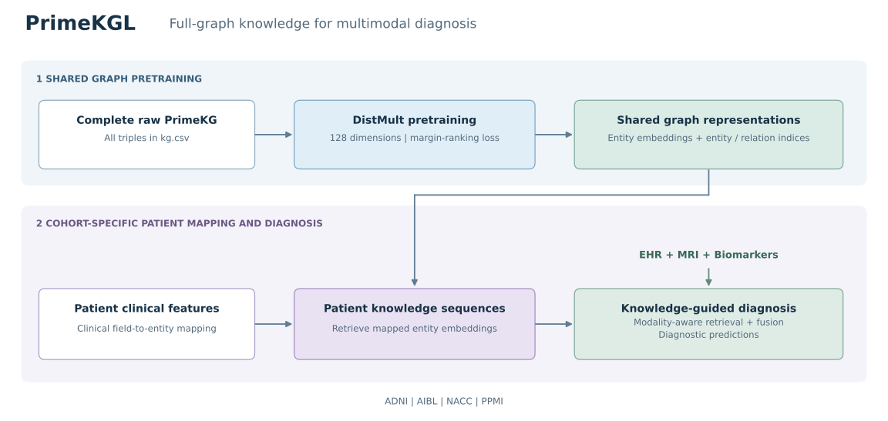
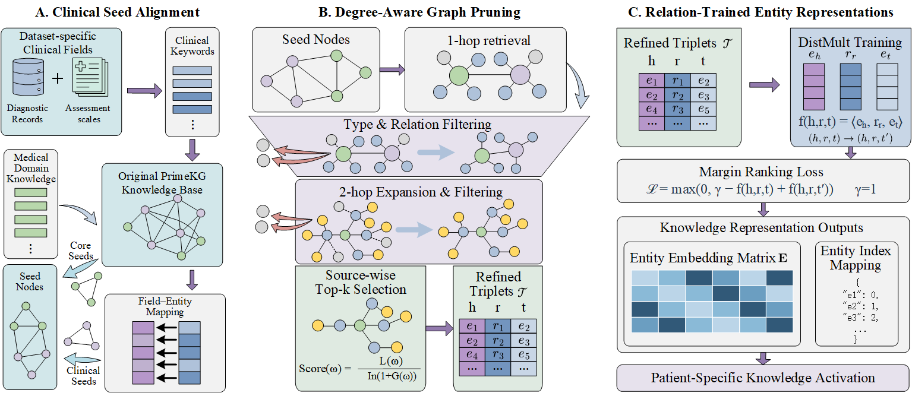

# clinicalKG: Knowledge-Guided Multimodal Diagnosis

In VS Code or Jupyter, open [Run_Experiments.ipynb](clinicalKG/run/Run_Experiments.ipynb), select the cohort, and run the notebook cells in order.

See the [run guide](clinicalKG/run/README.md) for cohort files, graph asset paths, and training entry points.

Knowledge-guided diagnostic models that combine electronic health records (EHR), magnetic resonance imaging (MRI), and biomarkers (BM) across **ADNI, AIBL, NACC, and PPMI**.

This branch provides two knowledge pipelines and a shared experiment runner for comparison with CustomKG.

| Project | Knowledge source | Documentation |
| --- | --- | --- |
| **PrimeKGL** | Shared DistMult representations learned from the complete raw PrimeKG | [Workflow and usage](clinicalKG/PrimeKGL/README.md) |
| **DemRKGL (KAMT_DemRKG)** | Clinically aligned DemRKG subgraphs with degree-aware pruning | [Workflow and usage](clinicalKG/KAMT_DemRKG/README.md) |

## PrimeKGL workflow



The complete PrimeKG is encoded once with DistMult. Each cohort maps patient clinical features to graph entities, retrieves their embeddings, and combines the resulting knowledge sequences with EHR, MRI, and biomarker representations for diagnosis.

## DemRKGL workflow



Clinical fields and medical domain knowledge identify seed entities in PrimeKG. Neighborhood retrieval, type and relation filtering, and source-wise top-k selection produce DemRKG. DistMult embeddings support patient-specific knowledge activation and the downstream multimodal diagnostic model.

## Dataset

The [dataset guide](clinicalKG/README.md#dataset-organization) lists the required clinical CSVs and MRI directories. Both PrimeKGL and DemRKGL use the same cohort data.

## Getting started

1. Install dependencies and configure data paths using the [clinicalKG setup guide](clinicalKG/README.md).
2. Prepare graph embeddings and patient mappings using the method-specific workflows above.
3. Open [Run_Experiments.ipynb](clinicalKG/run/Run_Experiments.ipynb) to check inputs, train CustomKG / Full PrimeKG / DemRKG configurations, and summarize metrics and paired statistics.

The [clinicalKG guide](clinicalKG/README.md) describes the directory layout, runtime options, evaluation protocol, and output files.

## Recommended deployment

Download the clinical CSVs, NIfTI volumes, and graph assets. Place the four cohort directories directly under `clinicalKG/` using the layout below.

```text
<REPO>/
  clinicalKG/
    requirements.txt
    run/
      README.md
      Run_Experiments.ipynb
      common/
    PrimeKGL/                         # Mapping and pretraining notebooks and cohort seed CSVs
    shared/FullPrimeKG/
      PrimeKG-Embeddings.npy
      PrimeKG-Entity2ID.json
      PrimeKG-TrainingState.json
    KAMT_DemRKG/                      # Construction notebooks, seed CSVs, and generated graph CSVs
    analysis/                         # Generated predictions, metrics, and checkpoints
    kg.csv                              # Original PrimeKG for graph generation
    ADNI/
      ADNI诊断.csv
      AD.csv
      ad_nii_KG/
      mci.csv
      NC_nii_KG/
      normal.csv
      normal_nii_kg/
      PrimeKG/
        ADNI-PrimeKG-Raw-Entities.json
      DementiaHKG/
        ADNI-DementiaHKG-Embeddings.npy
        ADNI-DementiaHKG-Entity2ID.json
        ADNI-DementiaHKG-Entities.json
      CustomKG/
        CustomKG-ADNI.npy
        CustomKG-ADNI.txt
    AIBL/
      AIBL诊断.csv
      AD.csv
      AD/
      MCI.csv
      MCI/
      NC.csv
      NC/
      PrimeKG/
        AIBL-PrimeKG-Raw-Entities.json
      DementiaHKG/
        AIBL-DementiaHKG-Embeddings.npy
        AIBL-DementiaHKG-Entity2ID.json
        AIBL-DementiaHKG-Entities.json
      CustomKG/
        CustomKG-AIBL.npy
        CustomKG-AIBL.txt
    NACC/
      NACC诊断.csv
      NACC_ad.csv
      NACC_nii_ad/
      NACC_mci.csv
      NACC_mci/
      NACC_normal.csv
      NACC_nii_no/
      PrimeKG/
        NACC-PrimeKG-Entities.json
      DementiaHKG/
        NACC-DementiaHKG-Embeddings.npy
        NACC-DementiaHKG-Entity2ID.json
        NACC-DementiaHKG-Entities.json
      CustomKG/
        CustomKG-NACC.npy
        CustomKG-NACC.txt
    PPMI/
      PPMI诊断.csv
      PD1.csv
      PD/
      control.csv
      Control/
      prodromal.csv
      Prodromal/
      swedd.csv
      SWEDD/
      PrimeKG/
        PPMI-PrimeKG-Entities.json
      DementiaHKG/
        PPMI-DementiaHKG-Embeddings.npy
        PPMI-DementiaHKG-Entity2ID.json
        PPMI-DementiaHKG-Entities.json
      CustomKG/
        CustomKG-PPMI.npy
        CustomKG-PPMI.txt
```

Set `CLINICALKG_PROJECT_ROOT` to the absolute path of the `clinicalKG/` directory.

When generating graph assets from scratch, place the original PrimeKG `kg.csv` at `clinicalKG/kg.csv`. A cohort directory under `clinicalKG/run/` takes precedence over the corresponding directory in this layout.

Open [Run_Experiments.ipynb](clinicalKG/run/Run_Experiments.ipynb) to compare methods. The [run guide](clinicalKG/run/README.md) documents graph inputs and result files.
