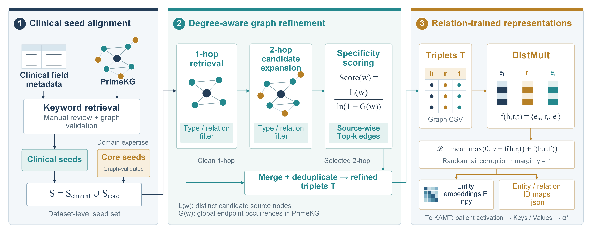
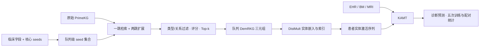
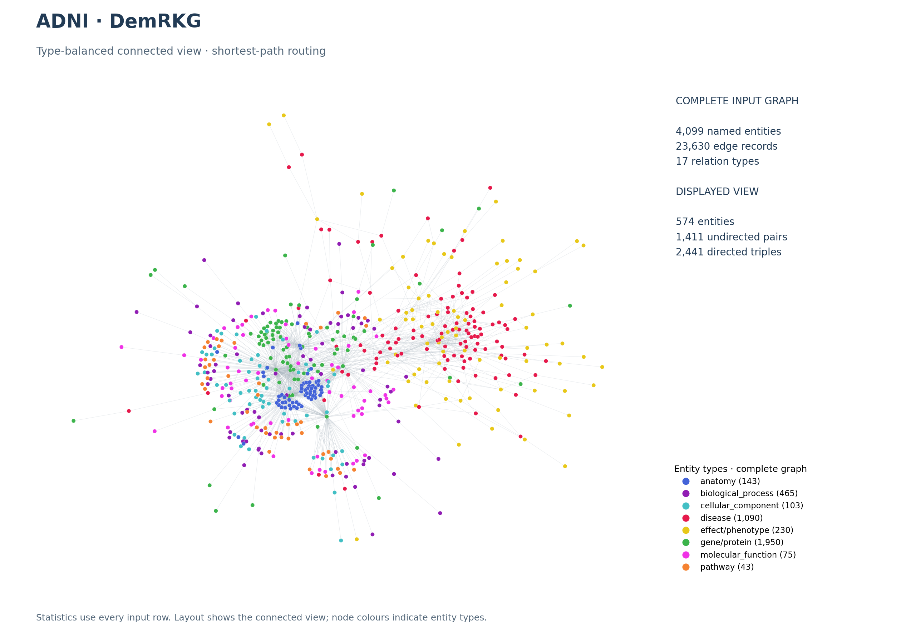
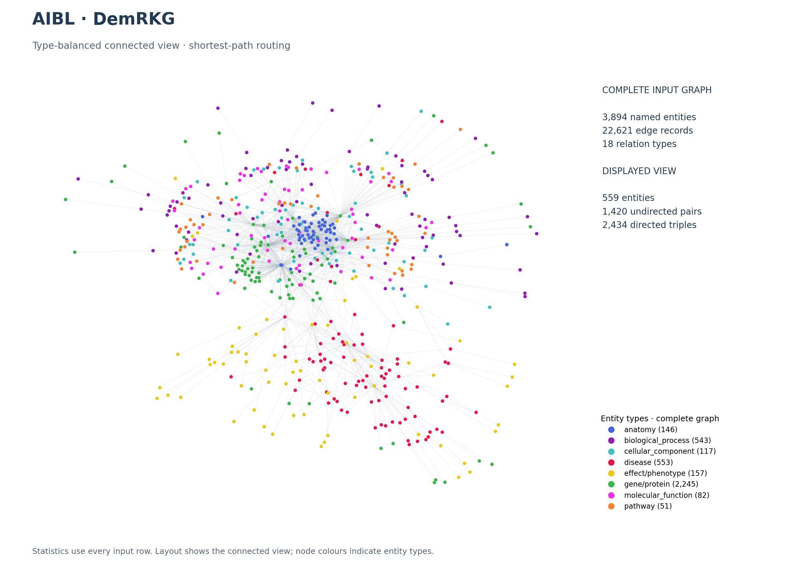
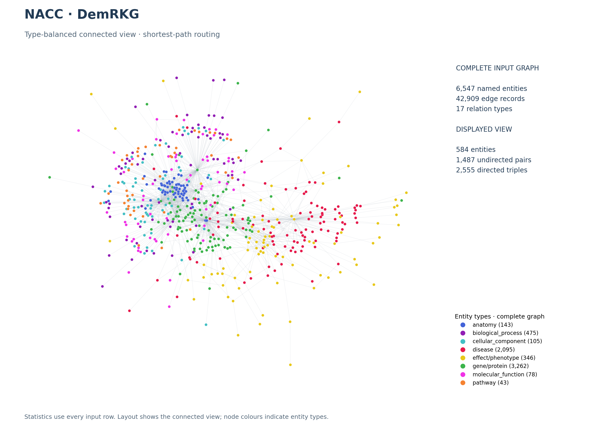
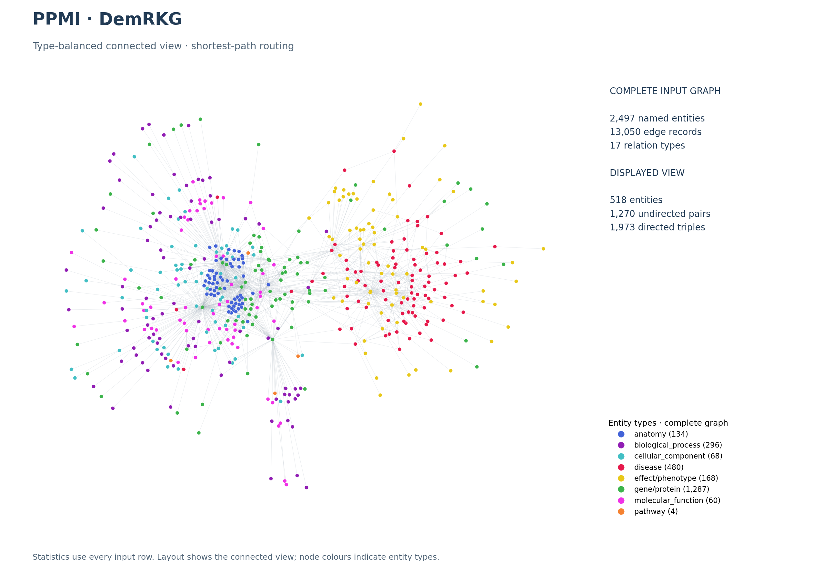

# DemRKL：DemRKG 构建与知识增强学习

DemRKL 为 ADNI、AIBL、NACC、PPMI 分别构建临床相关 DemRKG，并训练相应的 DistMult 嵌入及 KAMT 诊断模型。代码及生成资产沿用 `DementiaHKG` 名称，论文中使用 DemRKG。

## 构建流程与模型框架



构建流程包括临床字段与核心 seed 对齐、类型/关系过滤、一跳检索、两跳候选扩展、度数感知评分、按源节点选取 Top-k，以及合并去重。ADNI/NACC 的 k 为 5，AIBL/PPMI 的 k 为 6。输出关系三元组用于 DistMult 训练。




两幅框架图复用当前论文版本；建图框架另附 [SVG 源图](../figures/DemRKG-construction.svg)。

## 各队列实际图谱规模

以下数值于 2026-10-27 从各队列的详细 DemRKG CSV 重新统计。实体按名称去重，与当前 DistMult 实体索引一致；边记录为 CSV 行数；有向三元组按 `(head, relation, tail)` 去重。

| 图谱 | 实体（名称索引） | 实体类型 | 边记录 | 去重有向三元组 | 关系类型 |
|---|---:|---:|---:|---:|---:|
| ADNI | 4,099 | 8 | 23,630 | 23,630 | 17 |
| AIBL | 3,894 | 8 | 22,621 | 22,621 | 18 |
| NACC | 6,547 | 8 | 42,909 | 42,909 | 17 |
| PPMI | 2,497 | 8 | 13,050 | 13,050 | 17 |

详细实体类型分布、关系类型及其数量、来源路径与 SHA-256 见 [图谱规模审计](../GRAPH_STATISTICS.md)。对应的详细图谱文件为：

| 队列 | 项目根目录下的来源文件 |
|---|---|
| ADNI | `ADNI/DementiaHKG/DementiaHKG_PrimeKG_Sub.csv` |
| AIBL | `AIBL/DementiaHKG/AIBL_DementiaHKG_PrimeKG_Sub.csv` |
| NACC | `NACC/DementiaHKG/NACC_DementiaHKG_PrimeKG_Sub.csv` |
| PPMI | `PPMI/DementiaHKG/PPMI_DementiaHKG_PrimeKG_Sub.csv` |

绘图脚本优先查找本目录各队列副本文件夹中的同名 CSV，再查找上述原队列目录。`数据集-DementiaHKG-G.csv` 是用于嵌入训练的 `head/relation/tail` 格式，详细 CSV 同时提供绘图所需的实体类型。

## 图谱可视化

四个队列与 [Full PrimeKG](../PrimeKGL/README.md) 使用同一种连通采样方法及配色：从最大连通分量选取最高度根节点，每个实体类型最多随机选择 60 个目标，用最短路径连接并展示诱导子图。抽样种子为 42、布局种子为 2026。图内统计分为完整输入与展示子图两部分。

### ADNI



展示 574 个实体、1,411 个无向实体对。[SVG](figures/ADNI-graph.svg) · [规模统计](figures/ADNI-statistics.json) · [展示子图节点与关系](figures/ADNI-view.json)

### AIBL



展示 559 个实体、1,420 个无向实体对。[SVG](figures/AIBL-graph.svg) · [规模统计](figures/AIBL-statistics.json) · [展示子图节点与关系](figures/AIBL-view.json)

### NACC



展示 584 个实体、1,487 个无向实体对。[SVG](figures/NACC-graph.svg) · [规模统计](figures/NACC-statistics.json) · [展示子图节点与关系](figures/NACC-view.json)

### PPMI



展示 518 个实体、1,270 个无向实体对。[SVG](figures/PPMI-graph.svg) · [规模统计](figures/PPMI-statistics.json) · [展示子图节点与关系](figures/PPMI-view.json)

## 运行

从仓库根目录执行，安装 `clinicalKG/requirements.txt` 中的依赖：

```bash
# ADNI 示例；替换 ADNI 可选择其余队列
python clinicalKG/DemRKL/ADNI_DemRKL/ADNI_DemRKL_build.py --stage all
python clinicalKG/DemRKL/ADNI_DemRKL/ADNI_DemRKL_train.py
# 可分别运行 graph / map / kge / plot 阶段
python clinicalKG/DemRKL/ADNI_DemRKL/ADNI_DemRKL_build.py --stage graph

# 重新统计四个队列并生成 PNG / SVG / JSON
python clinicalKG/tools/graph_overview.py --graph DemRKL
```

三种 KG 的统一训练与统计入口是 [Run_Experiments.ipynb](../Run_Experiments.ipynb)。原图谱 CSV 在本地准备，字段—实体种子字典、建图代码、统计和绘图产物随仓库提供。更多数据与路径说明见 [clinicalKG README](../README.md)。
