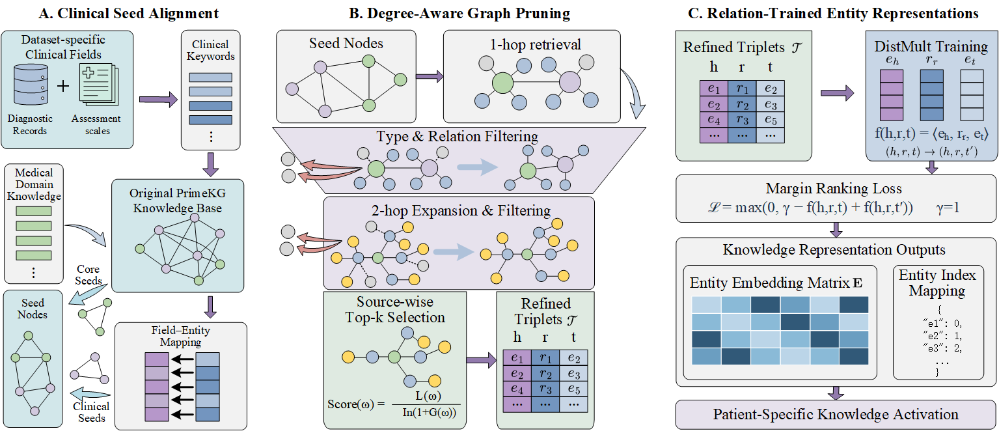

# DemRKGL (KAMT_DemRKG)

See the [run guide](../run/README.md) for cohort files, graph asset paths, and training entry points.

DemRKGL combines a clinically aligned **DemRKG** with knowledge-guided multimodal diagnosis. This directory, named `KAMT_DemRKG` in the codebase, contains disease search, clinical seed alignment, graph construction, patient mapping, DistMult pretraining, and diagnostic training for ADNI, AIBL, NACC, and PPMI.

## Workflow

The figure summarizes three stages that produce the graph representations used by the diagnostic model:

1. **Clinical seed alignment.** Extract clinical keywords from cohort-specific diagnostic records and assessment scales. Align these fields with PrimeKG entities and combine them with core seeds identified through medical domain knowledge.
2. **Degree-aware graph pruning.** Retrieve one-hop neighborhoods, apply entity-type and relation filters, expand to two-hop candidates, and perform source-wise top-k selection. Candidate ranking combines local connectivity with a penalty based on global graph degree to obtain the refined triples.
3. **Relation-trained entity representations.** Train DistMult on the refined triples with a margin-ranking objective. Export the entity embedding matrix and entity index for patient-specific knowledge activation.

The diagnostic stage retrieves each patient's mapped entity embeddings, integrates them with EHR, MRI, and biomarker representations, and fuses the resulting features for classification.

## Files

| File or group | Purpose |
| --- | --- |
| `<DATASET>_KAMT_DemRKG_disease_search.ipynb` | Search for relevant disease entities |
| `<DATASET>_KAMT_DemRKG_seed_mapping.ipynb` | Align clinical fields with seed entities |
| `<DATASET>_KAMT_DemRKG_build.ipynb` | Construct DemRKG, map patients, and train DistMult |
| Cohort diagnostic training notebooks | Standalone training for ADNI, AIBL, NACC, and PPMI |
| `<DATASET>_model.py` | Cohort-specific model implementations |

## Dataset

The [shared dataset guide](../README.md#dataset-organization) describes the ADNI, AIBL, NACC, and PPMI files and the clinical CSV / MRI directory layout. DemRKGL uses the same cohort inputs as PrimeKGL, together with clinical seed mappings and the constructed DemRKG representations.

## Usage

1. Follow the [clinicalKG guide](../README.md) to configure cohort data, the original PrimeKG, and local seed-mapping files.
2. Prepare clinical seeds by running the cohort's disease-search notebook followed by its seed-mapping notebook. Existing seed mappings can be supplied directly to the construction notebook.
3. Run the appropriate construction notebook: [ADNI](ADNI_KAMT_DemRKG_build.ipynb), [AIBL](AIBL_KAMT_DemRKG_build.ipynb), [NACC](NACC_KAMT_DemRKG_build.ipynb), or [PPMI](PPMI_KAMT_DemRKG_build.ipynb).
4. Open the cohort's diagnostic training notebook in this directory, or use [Run_Experiments.ipynb](../run/Run_Experiments.ipynb) to train and compare DemRKG, Full PrimeKG, and CustomKG.

## Graph settings and local assets

Construction notebooks define the entity-type and relation filters, two-hop scoring, top-k selection, and embedding settings. The source-wise selection uses **k = 5 for ADNI and NACC** and **k = 6 for AIBL and PPMI**.

Local assets include the clinical seed tables (`*_Seed_DementiaHKG.csv`), graph CSV files, patient-to-entity mappings, embeddings, and entity indices. The training workflow uses the name `DemRKG`; existing graph assets and the shared experiment runner use the internal identifier `DementiaHKG`.

Diagnostic predictions, checkpoints, metrics, and curves are saved in `clinicalKG/analysis/`. See the [shared evaluation guide](../README.md#evaluation-and-statistics) for final-epoch validation metrics and paired statistical analysis.
