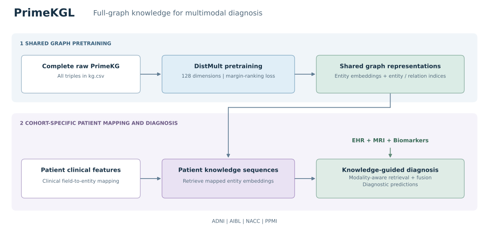

# PrimeKGL

Use the cohort folders below for step-by-step execution. The [batch guide](../run/README.md) covers training with prepared graph assets.

PrimeKGL combines representations learned from the **complete raw PrimeKG** with patient-specific entity mappings for multimodal diagnosis. ADNI, AIBL, NACC, and PPMI share the pretrained graph embeddings and entity index, while each cohort prepares its own patient mappings and trains its diagnostic model.

## Workflow

1. **Encode the complete graph.** Read every triple in the raw `kg.csv`, index its named entities and relations, and train DistMult with a margin-ranking objective and negative tail sampling.
2. **Share graph representations.** Save the entity embedding matrix, entity and relation indices, and resumable training state for reuse across the four cohorts.
3. **Map patients to entities.** Use cohort-specific clinical feature mappings to build each patient's entity sequence and retrieve the corresponding embeddings.
4. **Train the diagnostic model.** Encode EHR, MRI, and biomarkers, incorporate patient-specific knowledge through modality-aware retrieval, and fuse the representations for diagnosis.
5. **Evaluate repeated runs.** Use the shared experiment runner to collect final-epoch validation predictions, metrics, training curves, and paired statistics.

## Files

| File or group | Purpose |
| --- | --- |
| [Full_PrimeKG.ipynb](Full_PrimeKG.ipynb) | Shared graph pretraining with interruption recovery |
| [full_primekg.py](full_primekg.py) | Python implementation and command-line pretraining entry point |
| `Step3-Build-<DATASET>-PrimeKG.ipynb` | Cohort-specific patient mapping and shared asset loading |
| Cohort diagnostic training notebooks | Standalone training for ADNI, AIBL, NACC, and PPMI |
| `<DATASET>_model.py` | Cohort-specific model implementations |

## Dataset

The [shared dataset guide](../README.md#dataset-organization) describes the ADNI, AIBL, NACC, and PPMI files and the clinical CSV / MRI directory layout. PrimeKGL uses these cohort inputs together with the complete raw PrimeKG and shared graph embeddings.

## Run one cohort step by step

From the repository root, install the dependencies and start Jupyter with your data paths.

~~~powershell
python -m pip install -r clinicalKG/requirements.txt
$env:CLINICALKG_PROJECT_ROOT = "D:/data/cohorts"
$env:CLINICALKG_RAW_KG = "D:/data/PrimeKG/kg.csv"
$env:CLINICALKG_SEED_COUNT = "10"
python -m jupyterlab
~~~

Run [Full_PrimeKG.ipynb](Full_PrimeKG.ipynb) once before preparing any cohort, or point CLINICALKG_FULL_PRIMEKG_DIR to existing shared assets.

Open the guide for your cohort and execute its notebooks in order.

- [ADNI](ADNI/README.md)
- [AIBL](AIBL/README.md)
- [NACC](NACC/README.md)
- [PPMI](PPMI/README.md)

For batch diagnostic training, open [Run_PrimeKGL.ipynb](../run/Run_PrimeKGL.ipynb), choose DATASET and SEED_COUNT, and run the configuration cell with TRAIN = False to check inputs. Then set TRAIN = True and run the cell again.

## Command-line graph pretraining

~~~bash
python -m clinicalKG.PrimeKGL.full_primekg --raw-kg /path/to/kg.csv --epochs 50 --device cuda
~~~

Add --resume to continue from the saved checkpoint toward the same total epoch target.

## Pretraining settings and outputs

| Setting | Default |
| --- | --- |
| Embedding model | DistMult |
| Embedding dimension | 128 |
| Batch size | 512 |
| Learning rate | 0.005 |
| Pretraining epochs | 50 |

Pretraining uses the complete input graph's edge records and named entity and relation vocabulary. Shared outputs are stored locally in `clinicalKG/shared/FullPrimeKG/`:

- `PrimeKG-Embeddings.npy`: entity representations.
- `PrimeKG-Entity2ID.json` and `PrimeKG-Relation2ID.json`: graph indices.
- `PrimeKG-DistMult-last.pt` and `PrimeKG-TrainingState.json`: checkpoint and training metadata.
- `PrimeKG-LossHistory.json` and `PrimeKG-LossCurve.png`: pretraining loss records.

Existing `PrimeKG-*` assets in this method directory are also supported by the shared path resolver. Diagnostic predictions, checkpoints, metrics, and curves are stored in the local `clinicalKG/analysis/` directory. See the [evaluation and output guide](https://github.com/GoqiTea018/DemRKG-model/blob/clinicalKG/clinicalKG/run/README.md#recorded-results) for the shared protocol.

## Compare DemRKG and Full PrimeKG

Use the [clinicalKG comparison guide](https://github.com/GoqiTea018/DemRKG-model/blob/clinicalKG/clinicalKG/README.md) to run both methods under the shared protocol. The comparison reports accuracy, macro precision, macro recall, macro F1, and macro one-vs-rest ROC AUC on the epoch-200 validation split. The paired analysis reports metric differences on aligned predictions, bootstrap confidence intervals, permutation p-values, and Holm-adjusted p-values.
