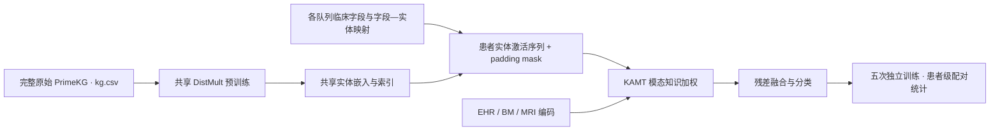
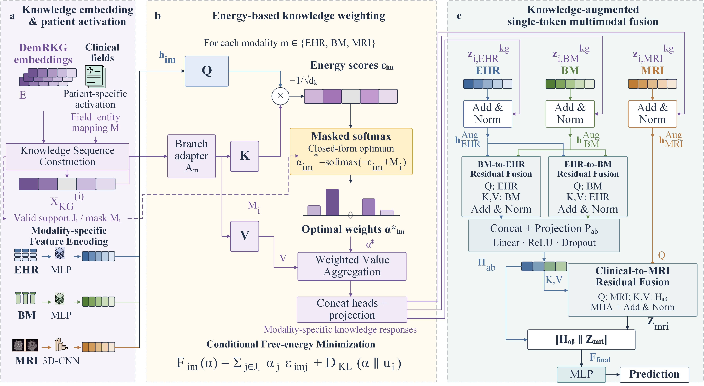
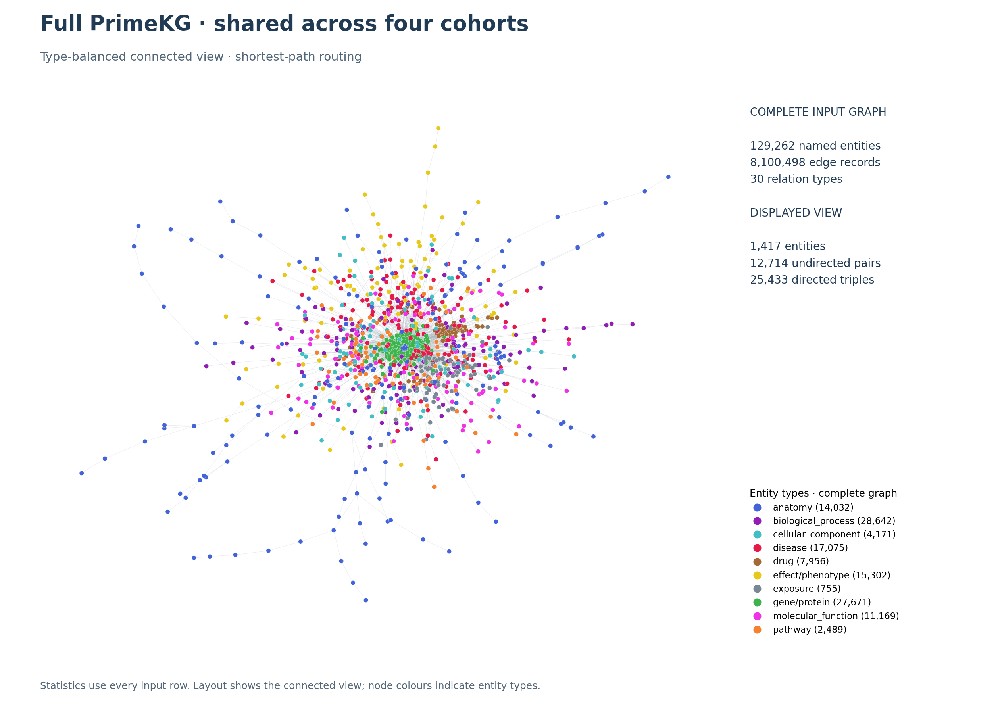

# PrimeKGL：完整 PrimeKG 知识增强学习

PrimeKGL 在完整原始 `kg.csv` 上训练一次 DistMult，ADNI、AIBL、NACC、PPMI 共用实体嵌入与索引。各队列根据自己的临床字段生成患者实体激活序列，再运行 KAMT 多模态诊断。完整图谱保留全部输入边记录、实体类型与关系类型。

## 运行流程





上图复用论文中的 KAMT 框架，左侧以 DemRKG 标注知识嵌入输入；PrimeKGL 在此处使用共享的 Full PrimeKG 嵌入。

## 实际图谱规模

以下数值于 2026-10-27 从完整 `kg.csv` 逐块统计，SHA-256 与本机 Full PrimeKG 训练状态中的图谱指纹一致。

| 图谱 | 实体（名称索引） | 实体类型 | 边记录 | 去重有向三元组 | 关系类型 |
|---|---:|---:|---:|---:|---:|
| FullPrimeKG | 129,262 | 10 | 8,100,498 | 8,099,991 | 30 |

原图包含 **129,375 个原始节点索引**；当前 DistMult 按实体名称建立索引，得到 **129,262 个名称实体**。表中实体数量与训练器口径一致。边记录按 CSV 行计数；去重有向三元组按 `(head, relation, tail)` 计数，镜像方向分别保留。同一实体对可能存在多类关系。

完整的实体类型分布、30 类关系数量、去重实体对数及来源文件见 [图谱规模审计](../GRAPH_STATISTICS.md) 和 [机器可读统计](figures/FullPrimeKG-statistics.json)。

## 图谱可视化



沿用原 DemRKG `Graph.ipynb` 的类型均衡连通采样思路：选择最大连通分量和最高度根节点，每类最多选取 60 个目标实体，用根节点到目标的最短路径连接，再展示所选节点的诱导子图。随机种子为 42，布局种子为 2026。图中标明完整输入规模与展示规模；当前展示 **1,417 个实体**。采样用于绘图，DistMult 训练仍读取完整图谱。

- [SVG 矢量图](figures/FullPrimeKG-graph.svg)
- [展示子图的节点与关系 JSON](figures/FullPrimeKG-view.json)：保留实体名、类型及全部去重有向关系，可追溯图中的真实连接。

## 运行

从仓库根目录执行，使用 Python 3.10+ 和 `clinicalKG/requirements.txt` 中的依赖：

```bash
# 共享预训练只运行一次；默认输出 clinicalKG/shared/FullPrimeKG/
python clinicalKG/full_primekg.py --raw-kg kg.csv --epochs 50 --device cuda
# 恢复已保存的训练
python clinicalKG/full_primekg.py --raw-kg kg.csv --epochs 50 --device cuda --resume

# 为一个队列生成患者映射；替换 ADNI 可选择其余队列
python clinicalKG/PrimeKGL/ADNI_PrimeKGL/ADNI_PrimeKGL_build.py --stage map
# 单独运行该队列的分类入口
python clinicalKG/PrimeKGL/ADNI_PrimeKGL/ADNI_PrimeKGL_train.py

# 重新统计完整图谱并生成 PNG / SVG / JSON
python clinicalKG/tools/graph_overview.py --graph PrimeKGL
```

三种 KG 的统一比较使用 [Run_Experiments.ipynb](../Run_Experiments.ipynb)，结果写入 `clinicalKG/results_full_primekg/数据集/`。单独 `*_train.py` 的结果默认位于 `clinicalKG/results/`。共享嵌入也支持放在本目录根部；路径解析见 [paths.py](../paths.py)。数据和续训设置见 [clinicalKG 总说明](../README.md)。

本目录下的 `ADNI_PrimeKGL/`、`AIBL_PrimeKGL/`、`NACC_PrimeKGL/`、`PPMI_PrimeKGL/` 各自包含建图/患者映射入口、诊断入口、notebook、模型和字段—实体种子字典。原始 `kg.csv`、大体积嵌入和检查点在本地准备，图谱统计与绘图产物随代码提供。
