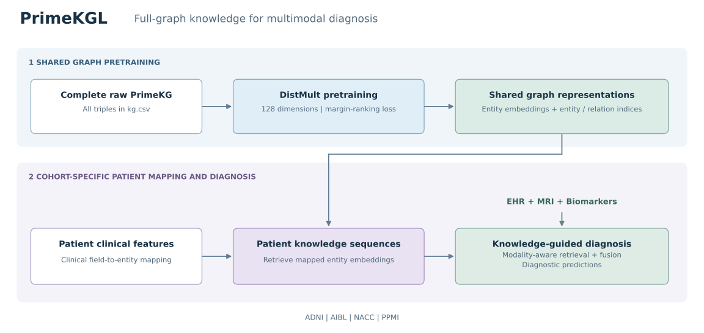
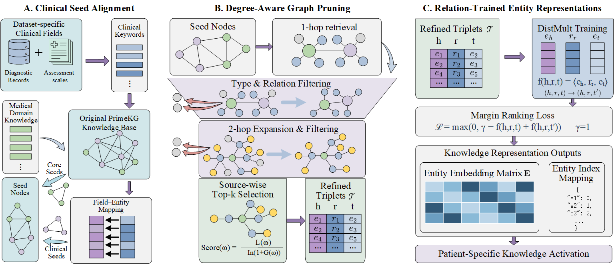

# clinicalKG

This package provides **PrimeKGL** and **DemRKGL (KAMT_DemRKG)** for knowledge-guided multimodal diagnosis across ADNI, AIBL, NACC, and PPMI. A shared experiment runner compares CustomKG, Full PrimeKG, and DemRKG using EHR, MRI, and biomarker inputs.

## Project workflows

### PrimeKGL



Train shared DistMult embeddings on the complete raw PrimeKG, map each patient's clinical features to graph entities, and combine patient-specific knowledge with the three clinical modalities. See the [PrimeKGL guide](PrimeKGL/README.md) for pretraining and mapping instructions.

### DemRKGL



Align clinical fields and medical domain knowledge with PrimeKG seed entities, construct DemRKG through neighborhood filtering and degree-aware selection, and train entity representations for patient-specific knowledge activation. See the [DemRKGL guide](KAMT_DemRKG/README.md) for construction and diagnostic training instructions.

## Directory layout

```text
clinicalKG/
|-- PrimeKGL/                  # Full PrimeKG pretraining, patient mapping, training
|   |-- Full_PrimeKG.ipynb
|   |-- full_primekg.py
|   |-- Step3-Build-*-PrimeKG.ipynb
|   `-- ...                    # Cohort training notebooks and *_model.py
|-- KAMT_DemRKG/               # DemRKG construction, patient mapping, training
|   |-- *_KAMT_DemRKG_disease_search.ipynb
|   |-- *_KAMT_DemRKG_seed_mapping.ipynb
|   |-- *_KAMT_DemRKG_build.ipynb
|   `-- ...                    # Cohort training notebooks and *_model.py
|-- run/
|   |-- Run_Experiments.ipynb   # Shared training, statistics, and curve generation
|   |-- common/                # Paths, splits, training, predictions, statistics
|   |-- record/                # Local working notes
|   `-- ...                    # Cohort CustomKG training notebooks
|-- docs/images/               # Project workflow figures
|-- analysis/                  # Local results in one flat directory
|-- shared/FullPrimeKG/         # Local shared graph assets
|-- tests/
`-- requirements.txt
```

Each method directory contains the four cohorts' notebooks and model implementations. Notebooks are the training entry points; `*_model.py` and `run/common/` provide the supporting implementation.

## Installation

Use Python 3.10 or later. Install a PyTorch / torchvision build compatible with your server's CUDA environment, then run from the repository root:

```bash
python -m pip install -r clinicalKG/requirements.txt
python -m jupyterlab
```

Open the relevant notebook and execute its cells in order. The shared entry point is [run/Run_Experiments.ipynb](run/Run_Experiments.ipynb).

## Data and graph paths

Paths are centralized in [run/common/paths.py](run/common/paths.py). Place each cohort's clinical CSV files, MRI folders, and graph assets under `clinicalKG/run/<DATASET>/`, or set `CLINICALKG_PROJECT_ROOT` to the parent directory containing `ADNI/`, `AIBL/`, `NACC/`, and `PPMI/` before starting Jupyter.

| Environment variable | Purpose |
| --- | --- |
| `CLINICALKG_PROJECT_ROOT` | Parent directory of the four cohort data directories |
| `CLINICALKG_RAW_KG` | Path to the complete raw PrimeKG `kg.csv` |
| `CLINICALKG_FULL_PRIMEKG_DIR` | Directory containing existing Full PrimeKG embeddings and indices |

For example, in a Bash session:

```bash
export CLINICALKG_PROJECT_ROOT=/path/to/cohort-data
export CLINICALKG_RAW_KG=/path/to/PrimeKG/kg.csv
python -m jupyterlab
```

In PowerShell, use `$env:CLINICALKG_PROJECT_ROOT = "D:/data"` and `$env:CLINICALKG_RAW_KG = "D:/data/kg.csv"`.

The `run/<DATASET>/` directory takes precedence over the corresponding directory under `CLINICALKG_PROJECT_ROOT`. Cohort-specific CSV and MRI folder names are defined in [run/common/config.py](run/common/config.py). Graph assets can reside in the method directory or in the cohort's `CustomKG/`, `PrimeKG/`, or `DementiaHKG/` directory.

Shared Full PrimeKG embeddings are resolved from `shared/FullPrimeKG/` or existing `PrimeKGL/PrimeKG-*` files. Raw data, embeddings, patient mappings, and experiment outputs are stored locally; workflow figures are included in the repository.

## Running the workflows

1. **Pretrain Full PrimeKG:** open [PrimeKGL/Full_PrimeKG.ipynb](PrimeKGL/Full_PrimeKG.ipynb). The four cohorts share one DistMult pretraining run. Set `RESUME=True` to continue an interrupted run.
2. **Prepare patient mappings and DemRKG:** follow the [PrimeKGL](PrimeKGL/README.md) and [DemRKGL](KAMT_DemRKG/README.md) guides.
3. **Train a single configuration:** open the cohort's diagnostic training notebook in the relevant method directory. CustomKG training notebooks are in `run/`.
4. **Run the shared comparison:** open [run/Run_Experiments.ipynb](run/Run_Experiments.ipynb) and configure the cohort, seed count, and run mode.

| Notebook option | Behavior |
| --- | --- |
| `DATASET_CHOICE` | `1=ADNI`, `2=NACC`, `3=AIBL`, `4=PPMI` |
| `SEED_COUNT=5` | Seeds: `11, 23, 37, 51, 67` |
| `SEED_COUNT=10` | Seeds: `51, 37, 67, 71, 109, 27, 11, 23, 97, 83` |
| `RUN_MODE="check"` | Check clinical data, MRI, and graph assets |
| `RUN_MODE="all"` | Train all three graph configurations and compute statistics |
| `RUN_MODE="train"` | Train the configurations and summarize metrics |
| `RUN_MODE="stats"` | Read saved predictions and compute statistics (default) |
| `RETRAIN=False` | Reuse completed runs with matching configurations |
| `RETRAIN=True` | Retrain the selected cohort and configuration, replacing its outputs |

Each graph configuration has a separate training cell. Re-execute the configuration cell after changing `SEED_COUNT`. For standalone notebooks, set `CLINICALKG_SEED_COUNT=5` or `10` before execution; `KG_ABLATION_SEEDS` supports custom seed lists outside the shared notebook.

## Evaluation and statistics

The shared runner and standalone diagnostic notebooks use [run/common/kg_ablation.py](run/common/kg_ablation.py). Training follows the existing record-level stratified split. The current diagnostic notebooks run for 200 epochs and evaluate the final model on the validation set.

Reported metrics are Accuracy, Macro-Precision, Macro-Recall, Macro-F1, and Macro-AUC. AIBL uses macro one-vs-one AUC; ADNI, NACC, and PPMI use macro one-vs-rest AUC. Paired analysis uses the same saved validation predictions and selected seeds to compute patient-level bootstrap confidence intervals, permutation-test p-values, and Holm-adjusted p-values.

Summary files and checkpoints record `evaluation_split=val`, `model_selection=final_epoch`, and the actual epoch. Epoch-level training and validation metrics are saved separately in history CSV files.

## Local outputs

Results are stored directly in `analysis/`. Method-specific files use `<DATASET>_<EXPERIMENT_TAG>_<GRAPH>_<FILE>`; cross-method summaries use `<DATASET>_<EXPERIMENT_TAG>_<FILE>`. The experiment tag contains the complete seed list.

For a five-seed ADNI run:

```text
analysis/ADNI_seeds_11-23-37-51-67_PrimeKG_seed_11.csv
analysis/ADNI_seeds_11-23-37-51-67_PrimeKG_history_seed_11.csv
analysis/ADNI_seeds_11-23-37-51-67_PrimeKG_last_seed_11.pt
analysis/ADNI_seeds_11-23-37-51-67_DementiaHKG_summary.csv
analysis/ADNI_seeds_11-23-37-51-67_metrics_mean_sd.csv
analysis/ADNI_seeds_11-23-37-51-67_paired_statistics.csv
analysis/ADNI_seeds_11-23-37-51-67_training_curves.png
```

Historical runs retain their experiment identifiers. Working notes are stored locally in `run/record/`, prefixed with the cohort name or `ALL_` for shared records.

## Checks

From the repository root:

```bash
python -m unittest discover -s clinicalKG/tests -p "test_*.py"
```

The checks cover notebook imports and paths, paired statistics on synthetic predictions, training artifacts, and Full PrimeKG checkpoint recovery.
